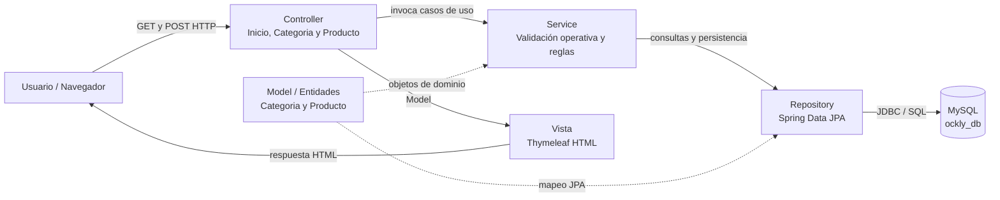
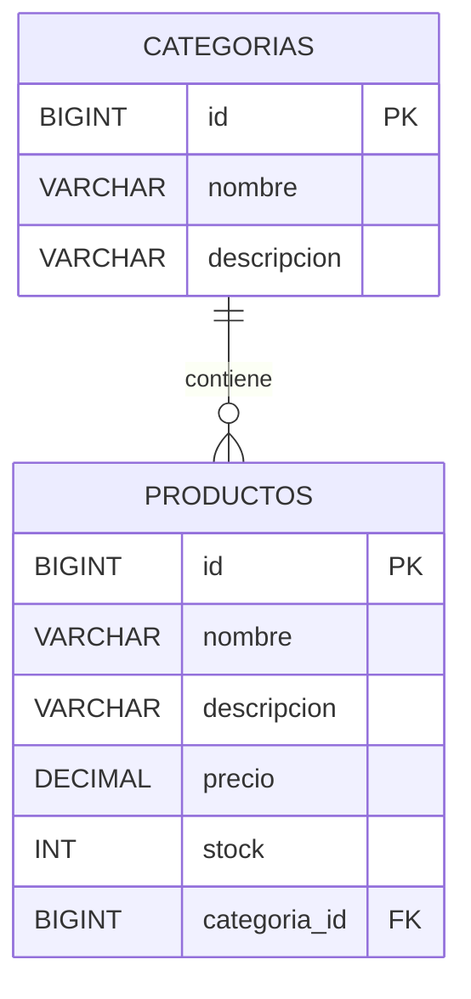

# Arquitectura MVC de Ockly

**Estilo:** Modelo–Vista–Controlador (MVC) con separación adicional Controller → Service → Repository. Esta elección responde a la nueva actividad de Spring Boot; no reemplaza el análisis conceptual anterior de Tuberías y Filtros.

La **Vista** contiene plantillas en `src/main/resources/templates`; el **Controlador** procesa las rutas HTTP y entrega datos a la vista; el **Modelo** define las dos entidades relacionadas. `service` concentra reglas de negocio; `repository` aísla el acceso a MySQL.

## Relación implementada

Una categoría tiene cero o muchos productos. Cada producto pertenece obligatoriamente a una categoría. La base de datos restringe borrar categorías que tengan productos asociados.

## Estructura de paquetes

- `controller/`: controladores MVC y endpoints HTTP.
- `model/`: entidades JPA `Categoria` y `Producto`.
- `dto/`: formulario `ProductoForm` con validaciones y `categoriaId`.
- `service/`: operaciones CRUD y verificación de la regla de borrado.
- `repository/`: interfaces `JpaRepository` para persistencia.
- `templates/`: pantallas Thymeleaf; `static/`: estilos CSS.
- `database/`: script SQL de creación de la base de datos.
- `src/test/`: pruebas de integración con H2 en perfil aislado.
